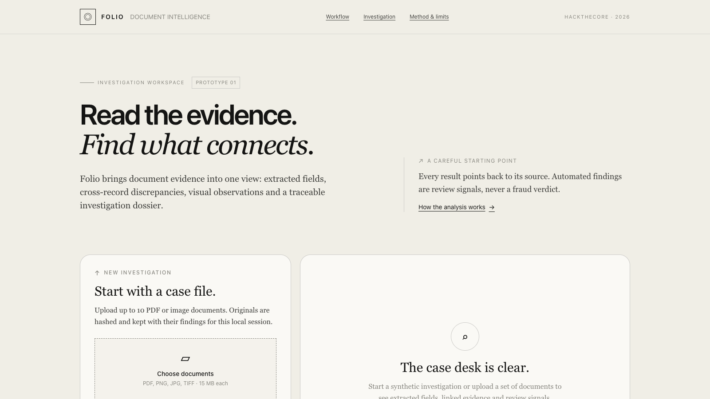
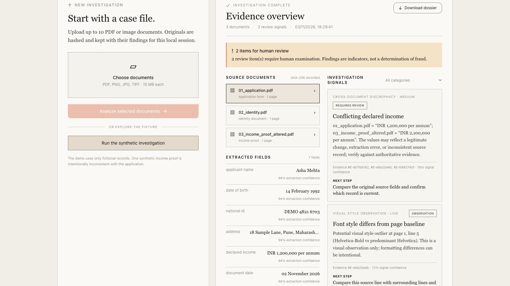
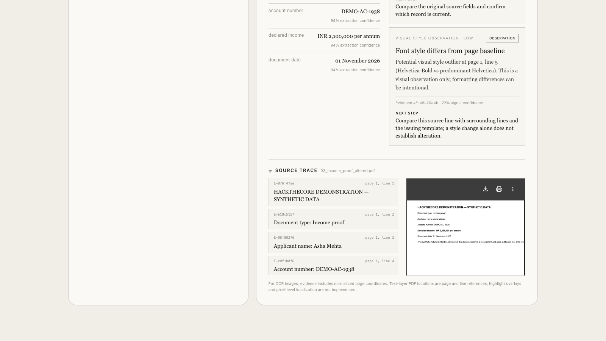

# Folio — AI-powered document forensics & contextual intelligence

**A [HackTheCore DataOps Innovation Hackathon](https://unstop.com/hackathons/dataops-innovation-hackathon-hackthecore-1765313) prototype**  
**Stack:** Java 21 + Spring Boot · Apache PDFBox · Tesseract OCR · React · Tailwind CSS

Folio turns a group of submitted documents into a structured, reviewable case file. It extracts supported fields, compares values across related documents, connects review signals to source evidence, and exports an investigation dossier. The interface is designed as a quiet field journal: warm ivory surfaces, editorial serif reading, restrained controls and one clay action.

> **Important:** Folio is a prototype. It reports review signals, not verified facts or fraud conclusions. A human must examine originals and verify consequential information with authoritative sources.

## Product screenshots

Screenshots below show Folio running the included synthetic case. All names, identifiers and document values are fictional.

### Workspace



### Investigation overview



### Evidence trace



## Run it

### Easiest: one command

Requirements: Java 21+, Maven 3.9+, Node.js 20+, npm, and (for scanned documents/images) Tesseract OCR with English data installed.

```bash
./run.sh
```

Open **http://localhost:5173**. The script installs frontend dependencies on first run, starts the Java API, then starts Vite. Stop both with `Ctrl+C`.

For the included synthetic PDF demo, the PDFs contain selectable text and do not require Tesseract. Tesseract is used automatically when a PDF has no usable text layer or when an image is uploaded.

### Start services separately

Terminal 1:

```bash
cd backend
mvn spring-boot:run
```

Terminal 2:

```bash
cd frontend
npm install
npm run dev
```

API health: http://localhost:8080/api/health  
Workspace: http://localhost:5173

On macOS, install Tesseract with `brew install tesseract`. On Debian/Ubuntu, install `tesseract-ocr` and `tesseract-ocr-eng`. For custom paths, set `TESSERACT_CMD`. Set `APP_STORAGE` to change the backend's local data directory.

## First 90 seconds

1. Open the workspace and click **Run the synthetic investigation**.
2. Inspect the three fictional documents and the conflicting declared-income signal.
3. Select a source and follow the evidence IDs to the source page/line.
4. Download and inspect the Markdown dossier.

The third fixture is intentionally inconsistent with the application and includes a deliberately different font on the declared-income line. It is labeled as synthetic and exists only to demonstrate cross-document comparison and a basic visual style observation. No genuine customer data is included.

## What the prototype does

| Challenge requirement | Folio implementation |
|---|---|
| Multiple document ingestion | Upload up to 10 PDF/image files per investigation; 15 MB per file |
| Classification | Heuristic document labels from filename and extracted text |
| OCR and structured extraction | PDF text layer via PDFBox; local Tesseract fallback; supported English field labels and per-field extraction confidence |
| Document structure | Field/value map linked to evidence line IDs |
| Contextual and cross-document analysis | Deterministic normalized comparisons for supported fields; missing applicant-name review signal |
| Visual observations | Basic PDF page font-family outlier check with source line reference; OCR word boxes; no claim of pixel-level tamper detection |
| Evidence traceability | Original file, SHA-256 ingest digest, page/line or normalized OCR box locator, evidence IDs |
| Investigation dossier | Markdown export with all six required sections, findings, evidence and limitations |
| Audit trail | Local JSONL completion event with document hashes and finding IDs |
| Interface | Responsive review workspace with original source and extracted evidence together |

## Repository map

```text
backend/                 Java 21 Spring Boot API and analysis pipeline
frontend/                React + Vite + Tailwind review workspace
docs/ARCHITECTURE.md     Architecture diagram and data flow
docs/TECHNICAL.md        Technology and methodology notes
docs/LIMITATIONS.md      Implemented, partial and unsupported capabilities
docs/images/             Real product screenshots used in this README
docs/DEMO_SCRIPT.md      Four-minute judges' walkthrough
docs/VIDEO_SCRIPT.md     Narration for the product demo video
docs/VIDEO_CAPTIONS.srt  Subtitle sidecar for the demo video
presentation/            PowerPoint deck
media/                   Human-narrated product screen capture
tools/                    Product demo capture script
samples/generated/       Included fictional PDFs used by the demo
samples/dossiers/        Included Markdown dossier and structured JSON example
run.sh                   One-command local launcher
```

## API

- `GET /api/health` — service status.
- `POST /api/investigations` — multipart form with one or more `files` fields.
- `POST /api/demo` — generates and analyzes the included synthetic fixture.
- `GET /api/investigations/{id}` — structured investigation result.
- `GET /api/investigations/{id}/documents/{docId}/source` — original uploaded source.
- `GET /api/investigations/{id}/dossier` — Markdown dossier download.

The UI proxies `/api` to `localhost:8080` in local development. Investigation lookup state is in memory and clears on backend restart; original files, dossier and JSONL event are written under `backend/data` by default. Remove that directory to delete locally stored cases.

## Deck and demonstration video

- [PowerPoint deck](presentation/Folio-Document-Forensics.pptx) — 10 slides in 16:9, styled with the Refero Anthropic visual direction and without the Gamma badge.
- [Product demo video](media/folio-demo.mp4) — human-narrated screen capture of the running app, covering the synthetic investigation, discrepancy review, source trace and human-review limits. Optional subtitle file: [docs/VIDEO_CAPTIONS.srt](docs/VIDEO_CAPTIONS.srt).
- [Voiceover script](docs/VIDEO_SCRIPT.md) and [capture script](tools/capture_demo.mjs). To record again, start the app with `./run.sh`, then run `FOLIO_VOICE_AUDIO=/path/to/voice.m4a FOLIO_DEMO_URL=http://127.0.0.1:5173/ node tools/capture_demo.mjs`. The capture script needs Playwright, Chrome and FFmpeg.

## Submission deliverables

- **Download the packaged submission:** [folio-forensics-submission.zip](folio-forensics-submission.zip), containing the source, documentation, screenshots, deck, sample data and demo video.
- **Working prototype:** run locally using `./run.sh`; no hosted service or API key required.
- **Architecture overview:** [docs/ARCHITECTURE.md](docs/ARCHITECTURE.md), including Mermaid data-flow diagram.
- **Sample dossier:** `samples/dossiers/sample-investigation.md` and `.json`, generated from the included synthetic PDFs using the same analysis pipeline. The live demo regenerates the PDFs and runs the identical pipeline.
- **Source repository:** this repository, setup steps and dependency notes below.
- **Demonstration dataset:** three included fictional PDFs in `samples/generated/`; one is intentionally inconsistent and has a deliberate font-style outlier.
- **Technical documentation:** [docs/TECHNICAL.md](docs/TECHNICAL.md).
- **Traceability demo:** use the source-trace panel and follow evidence IDs to page/line or OCR bounding-box locators.
- **Limitations and assumptions:** [docs/LIMITATIONS.md](docs/LIMITATIONS.md).
- **Judges' live demo:** [docs/DEMO_SCRIPT.md](docs/DEMO_SCRIPT.md).

## Technologies, model roles and licensing assumptions

- **Java / Spring Boot:** upload API and deterministic analysis orchestration. Spring Boot dependencies are Apache 2.0 licensed.
- **Apache PDFBox:** PDF text extraction and raster rendering. Apache License 2.0.
- **Tesseract OCR:** optional local English OCR for scanned inputs. Apache License 2.0; trained data and local package are separately distributed by the system package manager.
- **React:** interface library, MIT license.
- **Vite:** frontend build/development server, MIT license.
- **Tailwind CSS:** styling, MIT license.

Direct dependency versions are pinned in `backend/pom.xml` and `frontend/package.json`; transitive frontend versions are captured in `frontend/package-lock.json` and backend versions are resolved by Spring Boot dependency management. No proprietary model or external AI API is used. Explanations come from deterministic rules. Check upstream license notices before redistribution and retain the included frontend lock file in the submitted repository.

## Responsible use and evidence handling

Use only documents that you have permission to process. The prototype stores uploaded originals unchanged and records SHA-256 at ingestion, but does not establish provenance before upload and is not a certified chain-of-custody system. Avoid real personal data in demos. Findings are explainable prompts for review; OCR output is not ground truth, and no automated adverse decision should be made from Folio results.

## Build

```bash
cd backend && mvn package
cd ../frontend && npm install && npm run build
```

See [docs/TECHNICAL.md](docs/TECHNICAL.md) for extraction rules and [docs/LIMITATIONS.md](docs/LIMITATIONS.md) before presenting capability claims.
