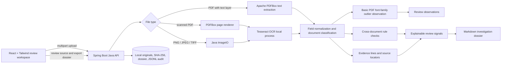

# Architecture overview

## Processing flow

1. The browser submits a bounded set of PDF or image files to the Java API.
2. Java validates file count, size and extension, stores an unchanged copy, and records a SHA-256 digest.
3. PDFBox extracts a PDF text layer. If it is effectively empty, PDFBox renders pages and the local Tesseract executable returns word boxes and recognition scores. Images use the same OCR path.
4. Supported labels are normalized into structured fields. Each field references the evidence line(s) used to extract it.
5. Rule-based comparisons find conflicting values across the submitted set and missing required applicant names. Findings include category, status, confidence, explanation, evidence IDs and a suggested human action.
6. A structured Markdown dossier includes document overview, extracted fields, contextual analysis, visual-processing observations, traceability and limitations. A JSONL event captures completion, hashes and finding IDs.
7. The React workspace displays findings beside the original PDF/image and the evidence locator. The dossier can be downloaded from the workspace.

## Components and roles

| Component | Role |
|---|---|
| Java 21, Spring Boot | Upload API, validation, orchestration, rules, audit and dossier |
| Apache PDFBox | PDF text extraction and rasterization |
| Tesseract OCR | Local English printed-text recognition with TSV word coordinates |
| React, Vite, Tailwind CSS | Review workspace and evidence display |
| Browser PDF/image viewer | View submitted original source |

There is no remote LLM or hosted OCR dependency. The prototype calls the results an investigation, but the implemented reasoning is deterministic and rule-based rather than generative AI. See [LIMITATIONS.md](LIMITATIONS.md).

## Data and trust boundaries

- All supplied examples are fictional synthetic fixtures. Users should only process documents they are authorized to use.
- The app writes original uploads and generated records to the configured local `APP_STORAGE` directory (default `backend/data` when launched from `backend`).
- The source digest demonstrates integrity checking after ingestion, not proof of provenance before ingestion.
- The audit JSONL is local and append-only in ordinary app operation, not tamper-proof or externally witnessed.
- Uploads are limited to 10 files per investigation and 15 MB per file. Investigation objects live in memory, so a restart clears the API lookup session even though artifacts remain on disk.
